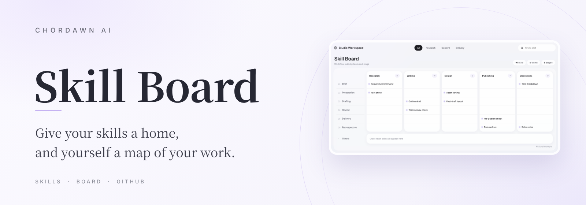
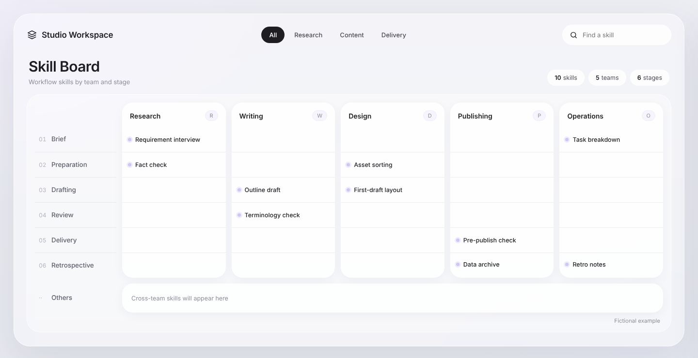
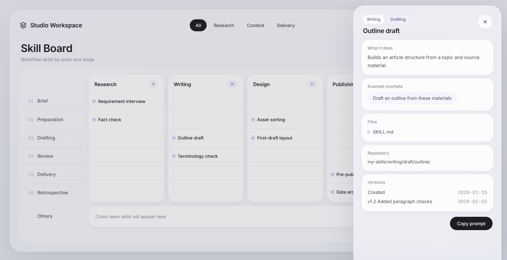

As you work alongside AI agents, skills pile up: a prompt that finally worked, a checklist learned the hard way, a method that became second nature. They end up scattered across folders and old conversations.

Skill Board lays your workflow out as a map. Columns are your teams or types of work, rows are your work stages, and every skill sits at its own coordinate. You see what you have built up so far, and the empty cells show where you could add next.

It is a ready-made visual template packaged as an agent skill, so you can skip the layout work and go straight to your own content.



Click any skill to open its details: what it does, example prompts, files, location and version history, plus one-click prompt copying.



> All content shown is a fictional example.

## Highlights

- **One HTML file.** No build step, no framework. Double-click to open.
- **Filter, search and explore.** Group tabs, a search box and a detail panel for every skill.
- **Fits your workflow.** Rows, columns and language are all yours to change: English, Chinese or any mix.

## Skills · Board · GitHub: how it fits into your day

Skill Board works best as one of three layers that keep each other up to date:

| Layer | Role | In practice |
|---|---|---|
| **Skills** | Grow while you work | Share notes, files and ideas with your agent as you go. At the end of a task, ask it to turn what worked into a new skill or an update, then confirm before it's saved. |
| **Board** | Shows where you are | Each new skill lands in its column and stage. Glance at the board to see what you've built and which gaps to fill next. |
| **GitHub** | Keeps it all in one place | Store your skills, memories and version history in a private repository. Once you grant access, agents on different platforms can read and update the same set. |

A simple rhythm: **work with your agent → save what you learned as a skill → let the board show where it belongs → keep everything in your private repo.**

## How to use

### Option 1: Let your agent build it (recommended)

1. Install the `skill-board/` folder as a skill in any agent that supports skills, such as Claude or Codex.
2. Tell your agent:
   > Use skill-board to turn my skills into a map of my work.
3. The agent will check your columns and stages with you, then build your board.

### Option 2: Edit it yourself

1. Open `skill-board/assets/board-template.html` in a text editor, not a browser.
2. Find the block marked `BOARD DATA`. It holds everything shown on the page: your workspace name, columns, stages and skills.
3. Replace the example entries with your own, save, and open the file in a browser.

You only touch the content; the styling stays as it is, so the layout won't break. For example, a skill looks like this:

```js
{ id: "Outline draft", col: "w", stage: "draft",
  desc: "Builds an article structure from a topic and source material.",
  prompts: ["Draft an outline from these materials"] }
```

Field-by-field notes are in [`data-format.md`](skill-board/references/data-format.md).

## Before you share

Your board may hold real clients, projects or internal paths. Before posting a screenshot or making a repository public, swap them for a fictional example.

## What's inside

```
skill-board/
├── SKILL.md                     # instructions for the agent
├── assets/board-template.html   # the template, with fictional sample data
└── references/
    ├── data-format.md           # every data field explained
    └── design-system.md         # colors, type and layout rules
```

## License

Free for **personal use only**: you may use and modify it in your own study and work. **No commercial use**, and no redistribution outside GitHub. Forks on GitHub are bound by the same terms. See [LICENSE](LICENSE) for details (English and Chinese).

---

Shared by **CHORDAWN AI · 半弦 AI**
